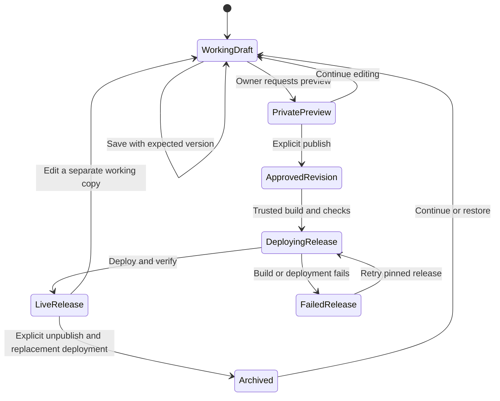

# Content lifecycle and security contracts

Status: Access requirements and security tradeoffs are partially accepted;
concrete contracts remain proposed. Angular replaces React/Next. Public SSG
and the dynamic editor are accepted; runtime/provider mechanisms remain open.
These are verification
contracts, not assertions of current enforcement.

Supabase-specific tables, SDK and policy mechanisms below are conditional
on choosing that provider and resolving dedicated capacity. A provider
change needs a deliberate decision and equivalent security contracts.

## Content model

| Record | Ownership and purpose |
| --- | --- |
| `content_entries` | Stable UUID, kind (`post` or `project`), slug, live revision pointer and archive state |
| `content_drafts` | One mutable working copy per entry, schema version and monotonically increasing draft version |
| `content_revisions` | Immutable snapshots created by publishing or explicit checkpoints; entry reference and versioned content |
| `revision_assets` | Exact asset references for each immutable revision |
| `media_assets` | Private storage key, verified type/dimensions, checksum and processing state |
| `slug_redirects` | Explicit permanent redirects for approved published-slug changes |
| `publication_jobs` | Durable deployment/invalidation work and completion/error status |
| `admin_audit` | Actor ID, action, entity/revision IDs and UTC timestamp; no complete content bodies |
| Private contact tables | Atomic quotas, request hashes and delivery status; no reusable public access |

Use PostgreSQL constraints for UUID relations, unique `(kind, slug)`, valid
states, non-negative versions and required metadata. Published revisions
cannot be edited in place. Use ISO dates/UTC timestamps in serialisable
public and HTTP models, not JavaScript `Date` objects across boundaries.

For SSG, add separate approved-publication and verified-deployment
records, release IDs and immutable entry/revision manifests. Public pages,
navigation, metadata and feeds use the deployed snapshot consistently.
The exact release schema remains open; do not assume a database live pointer
proves that generated HTML has deployed. See the rendering comparison.

Blog and project metadata share publication rules but have distinct schemas.
Blog metadata includes title, slug, excerpt, tags and publication/update dates.
Projects include problem, contribution, current status, technologies,
visibility, approved external links and display order. A private-source
project must not emit a private repository link as a public code action.
Professional contributions remain clearly distinguished from personal work.

## Structured editor document

The canonical body is `ContentDocument` version 1, a validated JSON tree.
Tiptap is an adapter to this format, not permission to persist arbitrary
extensions or executable markup. Allowed blocks are paragraphs, h2/h3
headings, ordered/unordered lists, quotes, code blocks, and approved images.
Allowed text marks are emphasis, strong, inline code and validated links.

Reject unknown nodes, excessive nesting, oversized text and invalid URLs.
Body cap: 256KiB serialised JSON, nesting depth <=12, <=2,000 nodes.
Title: 1–160 characters; slug: 1–100 lowercase ASCII characters/hyphens;
excerpt: <=320 characters; tags: <=10, each <=40 characters.
Schemas must define character-count conventions consistently in tests.

Public rendering uses explicit Angular components/templates with escaped text
and allowlisted elements. No database-supplied MDX, JavaScript, raw HTML,
eval, arbitrary iframe, innerHTML or bypassSecurityTrust path exists. Never
compile CMS text as an Angular template. Angular sanitisation complements
the restricted schema; it does not replace URL/document validation.
Links permit relative site paths, HTTPS, and explicitly supported mailto
addresses; deny active schemes and protocol-relative URLs. External links
have safe target/rel behaviour. Images refer to validated asset IDs.

Every read validates the stored schema version. Unsupported content produces
a controlled error; it must not be silently truncated or interpreted under
a different schema. Format changes require a versioned migration and tests.

## Editing and publishing

Autosave is debounced, visibly reports saving/saved/failed/conflict, and
never means published. Warn about unsaved edits before navigation. Failed
saves retain the buffer in memory; do not put private draft text into public
logs or browser local storage. Two tabs use expected-version comparison:
a stale write returns a conflict and never silently overwrites newer work.

Preview requires the owner session and MFA and uses the same renderer as
the public site. Do not create publicly shareable draft-preview URLs.
Never include drafts in public page payloads, API results, search, metadata,
RSS, sitemap, cache values or public assets.

Publish requires explicit review of the exact expected draft version.
The transaction locks the relevant records, verifies the expected version,
creates an immutable snapshot, records its approved assets, moves the live
pointer for approved publication and records a deployment job. This does not
move the verified-deployment record. All database changes commit together.
Publication RPCs enforce owner/MFA and critical data constraints; server
validation alone is insufficient protection for a directly callable RPC.

After commit, update pages, lists, metadata and feeds through a complete,
validated SSG build and verified deployment. Display approved/deploying/live/failed
states accurately. Failures remain retryable; reopening admin may trigger bounded
retries. Prevent older jobs overtaking newer releases. The accepted healthy
target is five minutes, subject to measurement. It is not a guarantee during
outages or exhausted quotas. The detailed pipeline remains proposed.

Unpublish removes the live pointer and updates discovery/detail routes.
SSG also needs a replacement deployment: changing SQL alone cannot withdraw
hosted HTML. Protect/remove historical deploy URLs and prevent rollback from
restoring withdrawn content. A five-minute healthy withdrawal target is proposed;
SSG cannot guarantee it during build/provider failures. Media caches remain
bounded at 300 seconds. Show delayed withdrawal and provide a tested operational
procedure. Already downloaded copies cannot be recalled. Errors never expose drafts.

Published slugs are stable. Renaming is a separate transaction that creates
a validated redirect without loops or collisions. Restoring old content
creates a new publication pointing to an appropriate immutable snapshot;
it does not rewrite history. Hard deletion requires checking references,
backups and the owner's explicit deletion request.

## Authentication and authorisation

The first release has one owner, not public membership. Provision the owner
out of band; disable public signup and anonymous sign-in. Use Supabase
email/password authentication and authenticator-app MFA. Additional editors
or identity providers require a decision change.

Identify the owner by a server-configured Auth UUID and a protected database
owner allowlist, not an email suffix, user-editable metadata or a client role.
Verify claims cryptographically with `getClaims`; use `getUser` when checking
fresh account state for sensitive mutations. Never authorise from an
unverified token/cookie or getSession result. A client Angular guard or decoded
JWT is not proof of identity. Use the verified claims for the selected runtime.
[Supabase verified claims](https://supabase.com/docs/reference/javascript/auth-getclaims).

All draft reads, media management and content writes require that owner
and `aal2`. The `aal1` owner can reach MFA enrollment/challenge and logout
only. Enforce both identity and MFA again in database policies and RPCs.
[Supabase MFA enforcement](https://supabase.com/docs/guides/auth/auth-mfa).

Session transport is open until the API runtime is chosen. Candidate A uses an
admin-only Supabase browser Auth client and bearer JWTs verified by each API
and database policy; tokens are browser-accessible, making strict private CSP
essential. Do not send owner credentials on public data requests. Candidate B
uses a same-origin Node session adapter with HttpOnly/Secure/SameSite cookies;
that needs explicit refresh/concurrency, logout and CSRF design and tests.
Neither is accepted implicitly by choosing Angular or SSR. Do not copy Next
cookie middleware or claim browser SDK sessions are HttpOnly.
[Supabase session tradeoffs](https://supabase.com/docs/guides/auth/server-side/advanced-guide).

Scope refresh handling to private/auth flows; do not refresh owner sessions
on public cached pages. Responses with `Set-Cookie` are private/no-store.
Logout clears local session state, and sensitive mutations reject revoked
or invalid accounts. Document recovery through the provider console,
session revocation and re-enrollment; verify that recovery cannot grant
content access before MFA is restored. Owner credentials are never seed data.

## Database and Storage access matrix

| Actor | Published projections | Drafts and history | Content mutation | Private contact records |
| --- | --- | --- | --- | --- |
| Anonymous | Live revisions and their approved media only | Denied | Denied | Denied |
| Non-owner authenticated user | Same public projection | Denied | Denied | Denied |
| Owner before MFA | Same public projection | Denied | Denied | Denied |
| Owner with MFA | Allowed | Allowed | Authorised RPCs/services | No general UI browsing in this release |
| Narrow server contact adapter | No CMS responsibility | No CMS responsibility | No CMS responsibility | Required reservation/status operations only |

Enable RLS and explicit grants on every exposed table. Public views must use
invoker security or an equivalently reviewed publication-only function.
An accidentally privileged view must not bypass row policies. Deny public
writes and direct updates to immutable publication records. Authorise
RPCs themselves; fix search paths for any security-definer functions and
grant execution only to their intended roles.

Privileged Supabase keys bypass normal RLS and are server-only. Isolate the
contact/operations adapter and forbid its import into CMS or public readers.
Do not assume a privileged key is safe because the tables have RLS.
[Supabase RLS and privileged keys](https://supabase.com/docs/guides/database/postgres/row-level-security).

Policy tests must call the data API/database directly with anonymous,
non-owner, `aal1`, `aal2` and expired/invalid credentials. UI-only tests cannot
prove these boundaries. Verify policies before importing actual content.

## Media handling

Store new media in a private bucket, using random immutable storage paths.
Permit verified JPEG, PNG and WebP only: <=2MiB, each dimension <=4096px,
and <=8 megapixels. Check decoded type and dimensions, not just filename or
claimed MIME. Re-encode and remove embedded metadata; reject uploaded SVG,
HTML and executable files. Trusted repository SVG illustrations are separate.

Process bounded sizes on the selected API runtime and store display variants.
Prove decoder/re-encoding support and memory/CPU limits before selecting a
library; Node sharp is not assumed portable to Deno or Workers. Do not rely
on paid Supabase image transformations. Failed processing remains a private
error state; publication rejects an unready or unreferenced asset. Require
alt text or an explicit decorative designation in the content document.

`/media/:assetId` checks an actual live revision reference before delivery.
Its Storage access uses publication-only RLS, not unrestricted secret-key
download. Draft preview uses owner-authenticated delivery with no-store.
Published binary cache lifetime is <=300 seconds; avoid indefinitely valid
public or signed draft URLs. Tests must request guessed IDs and old references.
[Storage access controls](https://supabase.com/docs/guides/storage/security/access-control).

## Contact submission contract

Public contact uses a typed protected HTTP API and a mailto fallback. Initial
HTML remains readable without JavaScript; API submission may need JavaScript.
Do not claim a no-JavaScript server form until one is deliberately implemented.
States: idle, submitting, invalid, accepted, rate-limited, uncertain, and
unavailable. Show field errors accessibly, preserve unsent input in memory,
and never show success until the email provider has accepted the request.
Accepted means queued by the provider, not delivered to the inbox.

Validate server-side: name 1–100 characters, email <=254 characters and
valid syntax, optional subject <=160 characters, message 10–5,000 characters.
Reject header/control-character injection and unexpected fields. No file
attachments. Limit the complete contact payload to 32KiB; keep a separate
bounded endpoint/upload policy for the CMS. Use a fixed configured recipient
and verified sender; the visitor's address is validated Reply-To only.

Require exact configured origin verification. Cookie-authenticated endpoints
need server-verified CSRF tokens; configure Angular's XSRF support for the actual
same-origin API and validate it server-side. Bearer-only endpoints reject
ambient-cookie authentication and use explicit origin/CORS rules. Origin and
CORS are not authentication. Reject null/missing origin unless a reviewed
alternative CSRF defence applies.
Do not trust arbitrary forwarded host/IP headers. Do not mistake CORS or a
honeypot for rate limiting.
[OWASP origin and CSRF guidance](https://cheatsheetseries.owasp.org/cheatsheets/Cross-Site_Request_Forgery_Prevention_Cheat_Sheet.html).

Reserve sending capacity atomically in PostgreSQL, across all server
instances: initially <=3 attempts per source in 10 minutes, <=10 per day,
and global ceilings <=80/day and <=2,500/month. Reconcile these with actual
shared-account quotas and tighten if needed. HMAC pseudonymous source/email
identifiers with a server secret; do not keep raw IPs in application records.
Configure trusted ingress IP extraction before relying on source limits.

A request UUID binds to a canonical payload hash. Retries reuse that UUID;
different content with the same UUID is rejected. Store reservation/status
and a provider request key for 24 hours, not the message body. Repeated
requests must not reserve capacity twice. Database/limiter failure fails
closed with an actionable mailto fallback, not an unprotected send.

Use the same provider idempotency key for bounded retries after a timeout
or transient provider response. Mark uncertain outcomes honestly, and do
not retry permanently rejected payloads. Resend retains idempotency keys
for 24 hours; retries after that horizon need a new deliberate submission.
[Resend idempotency](https://resend.com/docs/dashboard/emails/idempotency-keys).

No durable message queue is promised in this release: a failed request is
not silently stored for later sending. Counters expire after their windows;
operational logs omit body/email/IP, contain request IDs and error codes,
and expire after 14 days where the platform allows configuration. Mailbox
and provider retention must be documented separately in the privacy notice.

## Content Security Policy and secret handling

The owner accepted a reviewed cache-compatible public policy and stricter
admin/contact policy. The previous Next nonce/bootstrap design is superseded.
Angular-specific headers remain open until rendering/host/session selection.
No production unsafe-eval or unsafe-inline scripts are proposed. Use AOT and
external bootstrap/theme scripts or tested hashes. Angular runtime styles may
need CSP_NONCE/ngCspNonce or a reviewed style policy; static output cannot use
a unique per-request nonce without a request-time response transformation.
For SSR, never share-cache nonce-bearing HTML under a mismatched nonce header.
Test hydration, Tiptap, Angular controls and both themes with deployed headers.
Evaluate Trusted Types where supported and document actual browser coverage.
[Angular security/CSP](https://angular.dev/best-practices/security).

Restrict private connections to the required origin/Auth endpoints. Uploads
and AI use authenticated APIs. If static private shells cannot meet the
accepted stricter policy, revise the deployment mechanism explicitly before
implementation; do not silently weaken CSP to make controls work.

Use `object-src 'none'`, `base-uri 'self'`, `form-action 'self'`,
`frame-ancestors 'none'`, explicit image/connect sources and no arbitrary
image hosts. Verify security headers on the deployed response, not only
configuration files. Preview routes use noindex and access protection where
available; noindex is not access control.

Validate environment configuration at startup. Client-exposed configuration
contains only intentional public values. Supabase secret keys, email tokens,
HMAC secrets and AI tokens never enter browser bundles or public logs.
Preview/test credentials cannot access production resources.

## Optional AI editor assistance

AI is disabled initially and does not block CMS operation. Candidate actions
are rewriting a selected passage, proposing an excerpt, or suggesting tags.
The owner sees exactly what text will be sent, requests the operation, reviews
the result and explicitly accepts edits into a draft. AI cannot publish,
change access controls, invoke tools, or independently retrieve company data.

Send only selected, owner-reviewed text through an authenticated server
adapter. Treat prompts/content and returned text as untrusted data. Do not
send contact messages, secrets, work records or private repositories. Do not
log prompts or outputs. Review provider processing and model terms before
enabling the feature.

Cloudflare currently offers 10,000 neurons/day free; certain models require
billing. Select a free-eligible model deliberately, cap input/output and
daily use, and disable assistance on quota exhaustion or provider failure.
No automatic paid fallback or host migration is authorised.
[Workers AI pricing](https://developers.cloudflare.com/workers-ai/platform/pricing/).
